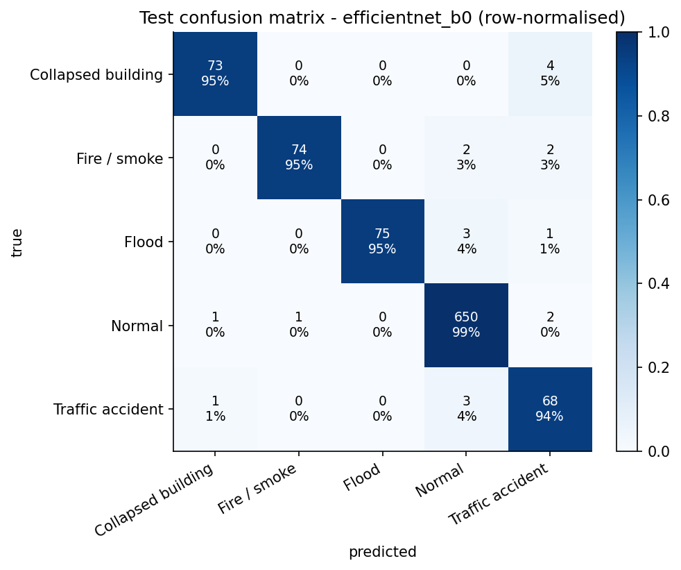
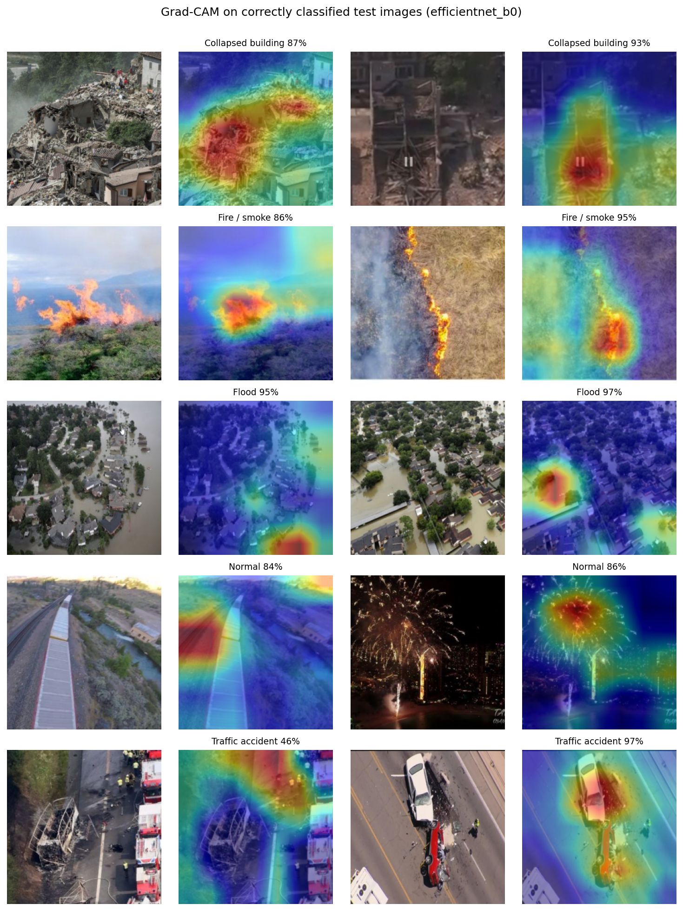
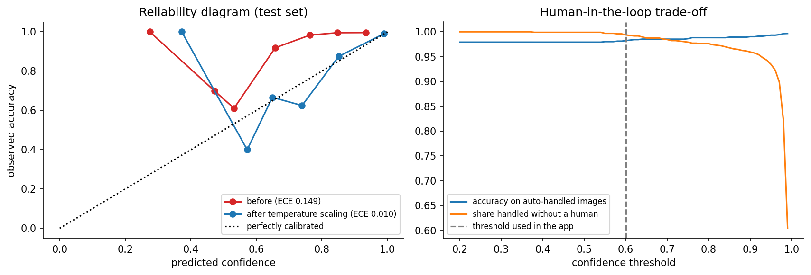
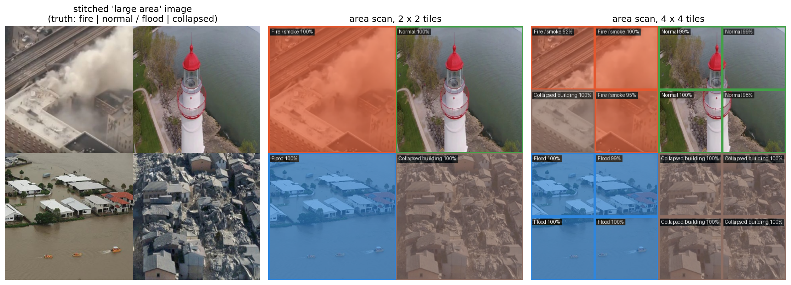

# 🛰️ Drishti — Explainable Drone-Based Disaster Recognition

**EC-422 Artificial Intelligence · IIT (BHU) Varanasi** · Team: *Name 1 (roll no.)*, *Name 2 (roll no.)*

**Live demo:** `https://huggingface.co/spaces/<hf-username>/drishti` · **Training notebook:** [`notebooks/drishti_train_kaggle.ipynb`](notebooks/drishti_train_kaggle.ipynb)

After a flood, fire or building collapse, emergency teams need to know *which areas are hit* — fast. A drone can photograph a whole district in minutes, but someone still has to look at thousands of frames.
**Drishti** (दृष्टि, "vision") is a deep-learning model that labels each aerial frame as **collapsed building, fire / smoke, flood, traffic accident** or **normal**, shows **where** it looked, suggests a **response**, and hands **uncertain** frames to a human analyst.

| Problem area | Approach | Deployment |
|---|---|---|
| Disaster management (course theme) | Transfer learning with CNNs (PyTorch) on the AIDER aerial dataset | Gradio web app on Hugging Face Spaces (free CPU) |

## Features

* **Two pretrained backbones compared** — MobileNetV3-Large (drone / edge device) vs EfficientNet-B0 (accuracy), two-stage fine-tuning, mixed precision, early stopping on macro-F1.
* **Honest evaluation** — near-duplicate images removed with perceptual hashing, stratified 70/15/15 split, model chosen on validation, final numbers on an untouched test set, macro-F1 for a dataset where about two-thirds of the images are "normal".
* **Aerial-specific augmentation** — flips and 90° rotations (a top-down image has no "up"), zoom, haze / lighting, blur, occlusion.
* **Explainability** — Grad-CAM heatmaps for correct *and* wrong predictions.
* **Trustworthy confidence** — temperature scaling (ECE before/after) and a human-in-the-loop threshold.
* **Area-scan mode** — tiles a large frame and maps where each emergency is, without any bounding-box labels.
* **Response playbook** — every alert comes with an India-specific action (NDRF/SDRF, 101 fire, 108 ambulance, ERSS 112).

## Results (held-out test set)

> Fill in from `results/model_comparison.csv` / the markdown table printed in section 11 of the notebook.

| Model | Params (M) | Size (MB) | CPU latency (ms) | Test accuracy | Test macro-F1 |
|---|---|---|---|---|---|
| MobileNetV3-Large | – | – | – | – | – |
| EfficientNet-B0 | – | – | – | – | – |

| Confusion matrix | Grad-CAM |
|---|---|
|  |  |

| Calibration & human-in-the-loop | Area scan |
|---|---|
|  |  |

## What is new compared with the AIDER / EmergencyNet reference code

The dataset authors published a Keras reference model, [EmergencyNet](https://github.com/ckyrkou/EmergencyNet). This project uses the same public data but a different, independently written pipeline:

| | EmergencyNet reference repo | Drishti |
|---|---|---|
| Framework | TensorFlow / Keras (pinned to TF 2.3, CUDA 10.1) | PyTorch 2.x, runs on a free Kaggle GPU |
| Model | custom ACFF CNN (~0.09 M parameters) trained from scratch for 200 epochs | ImageNet-pretrained MobileNetV3 / EfficientNet (~4 M parameters), up to 18 epochs, two-stage fine-tuning |
| Split | Keras `validation_split=0.2` (first 20 % of files per folder); best epoch picked on the same split that is reported | random stratified train / val / test; test set used only once; duplicates removed |
| Class imbalance | hand-set class weight (`normal: 0.35`), accuracy as metric | square-root inverse-frequency weights from the data, macro-F1 for selection |
| Explainability | — | Grad-CAM, failure analysis |
| Confidence | raw softmax | temperature-scaled probabilities, ECE, human-review threshold |
| Where is the disaster? | one label per image | area-scan tile map |
| Deployment | Android app shown as a figure (no code) | public Gradio app with alert card + response playbook |

## Repository structure

```
drishti-disaster-ai/
├── notebooks/drishti_train_kaggle.ipynb   # full pipeline: data -> training -> evaluation -> Grad-CAM -> export
├── app/                                   # exactly what is uploaded to the Hugging Face Space
│   ├── app.py                             # Gradio UI (analyze, area scan, about)
│   ├── drishti_core.py                    # model loading, calibrated prediction, Grad-CAM, tiling, alerts
│   ├── requirements.txt                   # CPU-only torch for the Space
│   ├── README.md                          # Space configuration (sdk: gradio)
│   ├── model/drishti_model.pt             # trained weights (from Kaggle)
│   └── examples/                          # sample test images for the demo
├── results/                               # figures + metrics copied from the Kaggle run
├── requirements.txt                       # local environment for the app
└── LICENSE
```

## Reproduce

**1 · Train on Kaggle (free GPU, ~20–30 min)** — create a notebook, *File → Import Notebook* → `notebooks/drishti_train_kaggle.ipynb`, set *Accelerator = GPU T4 x2* and *Internet = On*, then *Run All*. The notebook downloads AIDER from Zenodo itself and writes `drishti_outputs.zip` to `/kaggle/working`.

**2 · Run the app locally** (Python 3.11–3.13)

```bash
python -m venv .venv
# Windows: .venv\Scripts\activate      macOS / Linux: source .venv/bin/activate
pip install -r requirements.txt
python app/app.py          # opens on http://127.0.0.1:7860
```

**3 · Deploy** — create a Gradio Space on Hugging Face and upload the contents of `app/`:

```bash
pip install -U huggingface_hub
hf auth login
hf upload <hf-username>/drishti ./app . --repo-type=space
```

## Dataset and credits

* **AIDER** — C. Kyrkou and T. Theocharides, "EmergencyNet: Efficient Aerial Image Classification for Drone-Based Emergency Monitoring Using Atrous Convolutional Feature Fusion," *IEEE JSTARS*, vol. 13, pp. 1687–1699, 2020; and "Deep-Learning-Based Aerial Image Classification for Emergency Response Applications Using Unmanned Aerial Vehicles," *CVPR Workshops*, 2019. Data: Zenodo DOI [10.5281/zenodo.3888300](https://doi.org/10.5281/zenodo.3888300) (CC BY 4.0; the authors ask for non-commercial / academic use).
* Grad-CAM — Selvaraju et al., ICCV 2017. Temperature scaling — Guo et al., ICML 2017.
* MobileNetV3 — Howard et al., ICCV 2019. EfficientNet — Tan & Le, ICML 2019.

## License

Code: MIT (see `LICENSE`). Images belong to the AIDER authors.
